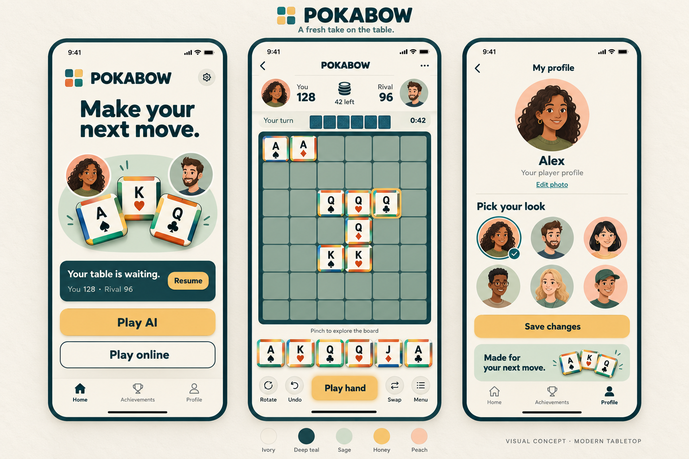

# Pokabow Design System — Modern Tabletop

**Status: Decided.** Approved by the owner on 2026-10-17. Version 1.14.
**Scope:** All new or redesigned game screens, UI components, graphics and layouts.
**Decision:** [ADR-020](decisions/ADR-020-modern-tabletop-design-system.md).
**Implementation:** Hub and its settings adopted on 2026-10-17; gameplay adopted on 2026-10-18. Shared theme tokens and screen verification are listed under Runtime adoption below.

## Direction
An inviting, contemporary tabletop game: warm ivory, deep teal, restrained honey accents, tactile square tiles and friendly 2D cartoon human avatars. The interface stays quiet enough for poker ranks and edge colours to carry the gameplay information.

## Authority and adoption

This document is the canonical visual standard for Pokabow. Read it before creating or changing a screen, component, layout, font, icon, avatar or other UI asset. Apply it to settings, matchmaking, achievements, help, dialogs, notifications and future approved features as well as the three pictured screens.

For visual decisions, this written specification takes precedence over its illustrative mockup and older visual references, incidental styles in existing code, and historical presentation notes. The game specification, accepted gameplay decisions and current behaviour remain authoritative for rules, feature availability, input, persistence and networking. Do not use a visual redesign to change those contracts.

The generated composition illustrates hierarchy and art direction; it is not an authoritative board position, grid measurement, exact font sample or scoring example. Written requirements resolve its illustrative differences, including the six-tile rack, responsive board crop, solid edge colours, action priority and availability of Skip.

Apply the standard to new UI and to the elements being redesigned. Existing screens can migrate incrementally. Their older appearance is implementation debt, not a second design system. Design approval alone does not migrate runtime scenes or assets; track implemented work below.

## Foundations
| Token | Hex | Intended use |
| --- | --- | --- |
| Canvas / tile face | #F6F2E9 | Main background and tile faces |
| Soft ivory | #EFEDE1 | Rounded secondary icon surfaces and the gameplay turn strip |
| Primary ink | #173D42 | Text, icons, board frame, resume card |
| Soft sage | #DFEAE4 | Secondary panels and quiet backgrounds |
| Honey | #F4C86A | Primary action, selected tile outline |
| Peach | #F4BC9E | Small avatar backdrops and illustration accents |
| Muted ink | #53686A | Supporting text |
| Board cell | #89A69C | Neutral empty squares |
| Heart / diamond face | #B83137 | Red suit and rank |
| Spade / club face | #192B30 | Black suit and rank |

Aim for roughly 70% neutral surfaces, 20% teal/sage structure and 10% accents on the home and profile screens. Gameplay naturally gives the board more space; do not force those percentages onto it.

Dark mode uses a separate midnight-teal palette:

| Role | Dark value | Use |
| --- | --- | --- |
| Canvas | `#101F26` | Page and bottom bar background |
| Raised surface | `#203841` | Settings, secondary surfaces and icon wells |
| Selected surface | `#2D4A50` | Current navigation destination and active cards |
| Primary text | `#F2F5EF` | Headings and controls on dark surfaces |
| Secondary text | `#BFD0D0` | Supporting copy and inactive navigation labels |
| Icon ink | `#E8F2EC` | Monochrome icons on dark surfaces |
| Border | `#47656B` | Dividers and outlined secondary controls |

Use light-stroke SVG variants for monochrome icons on dark surfaces; a theme
tint cannot lighten an SVG whose paths are already dark. Keep selected navigation
visible through its filled surface and stronger label as well as colour. Use deep
teal `#173D42` text on honey `#F4C86A` primary buttons in both themes. Disabled
secondary actions lose opacity without darkening their icon paths. Keep the four
gameplay edge colours unchanged. Tile faces remain ivory so rank/suit contrast
and tile recognition stay consistent.

Keep edge colours semantically separate from UI accents. Preserve the current TilePainter palette: Blue #0072B2, Red/Vermilion #D55E00, Green #009E73, Yellow #F0E442. Each of the four sides uses one solid colour; no gradients along an edge, no fifth edge colour. Honey is an interface accent, not an extra matching category. The raster mockup's softer edge rendering is illustrative.

## Typography
**Fredoka is the approved interface font**, replacing Dosis by owner decision on
2026-10-18. Use its real weights at normal width: Bold (700) for the wordmark and
headline, Semibold (600) for buttons and section labels, Medium (500) for stronger
labels and the gameplay interface, and Regular (400) for supporting/body text.
Do not simulate bold or stretch glyphs to approximate the concept.

The [bundled font resources and provenance](../assets/fonts/fredoka/README.md)
include [SIL Open Font License 1.1](../assets/fonts/fredoka/OFL.txt). Retain the
copyright and licence when shipping; the Android export preset explicitly includes
the licence. The original concept contains generated lettering, so match its
rounded weight, optical size and hierarchy rather than claiming an exact font
match.

At a 390px-wide design reference:
- Screen title: 26–30px bold.
- Home headline: 36–40px bold, at most three lines.
- Player score: 24–28px bold; reserve consistent width for changing values.
- Body and secondary action labels: 16–18px regular, medium or semibold.
- Primary play buttons: 20–22px semibold.
- POKABOW wordmark: approximately 30px bold.
- Supporting labels: 13–14px; avoid essential copy below 14px.
- Tile rank: about 40–46% of face width, with a distinct suit beneath.

Use a spacing scale of 4, 8, 12, 16, 24 and 32px. Screen padding 16–20px. Cards 18–24px corner radius; buttons 14–18px; square tiles 6–8px at rack size. Keep tile corners small enough that all four bands remain readable.

These are screen-space design dimensions, not literal Godot coordinates. Convert
them into the project's 540px-wide logical canvas, then check at 360px device
width. The hub uses the following reference sizes, with responsive minimums for
small direct viewports:

| Hub element | Fredoka weight | 540px logical size | Approximate size at 390px width |
| --- | --- | --- | --- |
| Hub wordmark | 700 | 55 | 40 |
| Primary play labels | 600 | 30 | 22 |
| Resume-card heading | 600 | 26 | 19 |
| Rival name / Resume action | 600 | 24 | 17 |
| Saved-game score | 400 | 22 | 16 |
| Navigation / supporting caption | 400–600 | 20 | 14 |

Check text fit using the actual rendered font and preserve touch targets when
adjusting typography. The reference image is illustrative; platform text
rasterisation can differ.

## Achievement collections
Owner-approved [category browser reference](design/achievement-categories-reference.png).
Keep the overview compact: an account collection summary, up to three unlocked
highlights, and a two-column category grid. The catalogue determines which
categories exist. Do not show sample counts, fictitious achievements or empty
future categories from the concept as live account data.

Selecting a category opens a two-column grid of at most six badges per page.
Provide All / Unlocked / Locked filters, a search field, and bounded previous/next
page controls. Category cards are also paginated when there are more than six.
Use a badge illustration, short title, and explicit unlock status; reveal the API
description in a dismissible detail panel, including for locked achievements.
Use the hub's Home / Achievements / Tournaments bottom navigation, with Achievements
selected on this screen. Tournaments shows a coming-soon placeholder;
Shop and Profile remain in the hub header. Short screens may scroll the current page's
content, while navigation and pagination remain fixed.
Use the shared arrow-and-bullseye outline icon for Achievements in both light
and dark navigation states.

Use real unlock dates for "Recently unlocked"; otherwise label the section
"Unlocked highlights". API-provided categories take priority. Known initial IDs
map to Hands, Edge Matching or Victories; uncategorised future IDs fall back to
Milestones and remain visible. Use a generic star until custom badge art exists.
Loading, empty, no-results, offline and retry states must remain understandable.
A failed refresh preserves the already loaded collection. No UI action grants
an achievement or changes its gameplay trigger.

Progress achievements show a numeric current/target count on locked badges and
details. A newly earned achievement uses one compact, app-level, non-blocking
banner above the current screen with its badge, "Achievement Unlocked" heading,
catalog name and description. Limit long descriptions to two lines in the banner;
the full description remains available in the achievement collection. Queue
simultaneous unlocks; use the shared canvas, ink, sage and honey
tokens with Fredoka typography. This achievement toast is separate from the
gameplay turn-status notices described in the mobile UX section.

## Gem shop

The owner-reviewed [Gem shop concept](design/gem-shop-concept-v2.svg) is implemented
as a scrollable offer preview with fixed Home / Achievements / Tournaments navigation.
Use faceted teal Gems with internal lines and highlights, matching the cartoon
avatar treatment. Show the confirmed account wallet balance or an unavailable
state. The daily ad gift grants 20 Gems only after a verified AdMob callback and
is unavailable for 24 hours after a confirmed grant. The offer panel shows when
it can be used again. Four cash packs remain illustrative placeholders; taps
explain their status without changing Gems.

The [light](design/gem-shop-runtime-390.png) and
[dark](design/gem-shop-runtime-dark-390.png) 390×844 runtime previews were
visually checked. Godot 4.6 store validation covers five viewport sizes, including navigation and minimum touch
targets. Physical Android and iOS device checks remain outstanding.

The hub Gem chip opens a dedicated account history screen. It shows the server-confirmed
balance and each transaction returned by the wallet endpoint, with its source, amount
and date. My Profile no longer repeats this information. The Shop icon continues to
open offers. The wallet endpoint currently returns the latest 50 transactions; the
history screen states that limit when reached. Advert and purchase rows can be
labelled when those transaction kinds exist. Rewarded ad grants require verified
server callbacks; purchases remain placeholders.
The [light](design/gem-history-runtime-light-390.png) and
[dark](design/gem-history-runtime-dark-390.png) 390×844 runtime views were visually
checked; physical device checks remain outstanding.

## Splash screen
The new CHIBI opening card appears first on a black canvas for one second. Its
centered slate and ivory angular mark carries the exact CHIBI name and expressive
cartoon eyes without eyebrows. The card then hands off to the established welcome
splash and its real loading indicator. The engine boot background is black to
match the first frame. This is a separate identity card; the Modern Tabletop
requirements below continue to govern the POKABOW welcome splash.

Owner-approved concept: [A little table, a big welcome](design/splash-welcome-concept-v1.png).
Use an ivory canvas, the shared four-square brand mark, a prominent deep-teal Fredoka
Bold wordmark, and the native-text tagline "Make your next move." The separate
transparent cartoon hero features the two players and three rank-and-suit tiles.
Keep the composition centered with generous space and preserve the artwork's aspect ratio.

Show four rounded loading tiles and "Setting the table..." beneath the illustration.
The tiles reflect actual startup warm-up progress; do not introduce a simulated
percentage, looping animation, or additional wait. Completed tiles are teal, the
current tile is honey, and pending tiles are sage. At completion, retain three teal
tiles and one honey tile during the existing branding hold. This treatment uses no
motion and therefore also serves reduced-motion users. Preserve the terms/account
gate and hub routing. Match the engine boot background to the black opening card.
Show the project version in small muted Fredoka text at the bottom of the
authored splash, below the loading caption. Read `application/config/version`
from Project Settings so the splash and exported version name share one value.

## Home
1. A centered, compact header group with the confirmed Gem balance chip, Shop, Profile, Sound and Settings. The chip uses the Shop Gem's faceted diamond geometry in the same outline style as the other header icons. It also opens Shop; show a dash until a confirmed balance arrives.
2. Center the POKABOW mark and wordmark in the former headline position, above the restrained tile-and-avatar illustration. Omit the “Make your next move.” headline.
3. Resume card when a saved game exists; expand to the existing active-game list when there are several. Keep its content driven by actual match data.
4. One primary **Play Now** action; the next screen offers AI rival and Online modes with AI selected initially.
5. Home / Achievements / Tournaments bottom navigation. Tournaments shows a coming-soon placeholder. Shop opens the Gem offers, with one verified rewarded ad available every 24 hours after a grant; purchase actions remain previews.

### Your tables and match history (approved 2026-10-21)

The owner-approved [hub tables concept](design/hub-tables-reference-v1.png) and
[completed-match detail concept](design/match-history-detail-reference-v1.png)
extend Home. The images illustrate hierarchy and art direction; names, scores,
dates and end reasons in them are sample data. Live UI must use persisted match
records and never show these sample results as if they belonged to the player.

Keep the hub's **Your tables** section to one prioritised active match and the
most recently completed match, with a compact **View all ›** affordance. If more
active matches exist, show their count as a link to the full list rather than
growing the hub card indefinitely. Keep Play Now and fixed Home /
Achievements / Tournaments navigation reachable, with Shop and Profile in the header. A shorter hero may yield space to
the match summary on narrow phones; do not shrink essential text or tap targets.
Place **Your tables** as a section heading outside and above the match cards.
Put **View all ›** on the same header row, right aligned. Give the resumable
match and the most recent completed match separate sage panels with a visible
canvas gap. Show each panel only when that type of match exists. Keep the
resumable panel limited to its match details and the extra-active count link.

An active row shows the rival's portrait, explicit turn/resume status, rival
name, current scores and a honey **Resume** action routed to that exact match.
Do not repeat **Active** beside a Resume action or add a separate active dot.
A completed row shows a textual **Win**, **Draw** or **Loss** without a
**Latest Result** prefix, alongside the rival portrait and name, final
scores and completion date. Use the green dot for a player win; use muted ink
for draws and losses so green never implies the player won. Do not infer a win
from score alone: resignation may award it to the lower scorer.

**Details ›** and **View all ›** use a compact right-facing chevron after the
label to signal forward navigation. It is a navigation affordance, not a
separate action or a substitute for the label. Give the complete row/button a
minimum 48px physical touch target, preserve the text label for screen readers,
and avoid colour-only states. The full list groups Active and Completed entries;
its empty states use plain copy and do not invent fixtures.

Tapping Details opens a read-only view of that specific completed match. Reuse
the results hierarchy: outcome, equal-size portraits and final totals, labelled
Winner badge, poker/edge/cluster breakdown, end reason and move count. The
screen has a back route to the tables list; **Back to tables** is the primary
honey action. Show a secondary Share action only for a player win. Scores and
outcome come from the completed match record; presentation does not recalculate
game rules. A missing portrait falls back to the shared cartoon rival avatar.

Keep the Play Now button honey yellow in its enabled state, including when a
resumable match exists. The active match's Resume button also uses honey.

The later approved Gem header chip displays the existing confirmed wallet balance only; it does not award or spend Gems. Tournaments remains a placeholder until its rules and destination are specified.

The separately approved Table Level feature (2026-10-20) uses a compact sage
profile card with an ink level label, a honey XP bar and a muted Online Tier
label. The lobby may show the opponent's tier as supporting text. Keep these
markers readable at phone width and separate Table Level from online skill.

## Play AI / opponent selection
Owner-approved [Play AI concept](design/play-ai-reference-v1.png). Use a compact
brand/back header, a clear page title, AI rival / Online mode segments, a sage
You vs rival portrait panel, explicit Easy / Medium / Hard segments and a single
honey **Choose rival** action. Use native Fredoka text and the existing cartoon
roster; difficulty must never be inferred from a character's appearance.
Selection uses a filled teal surface and a checkmark. Keep the actual default
difficulty from AiEnums; the concept's Medium selection is illustrative.

The main action and back route stay reachable while central content may scroll.
On short screens, reduce the portrait size and remove decorative tiles first.
Preserve uploaded player photos, random selection among the named rivals in the
chosen fixed difficulty tier, and automatic match
handoff. During online search, cycle the shared cartoon roster until an opponent
is found; an immediate pairing still gets a randomized 3–5 second reveal.
Then show the real opponent name and uploaded portrait, count down “Joining in
3…2…1” in the disabled main action, and submit readiness automatically. Keep
an adjacent Cancel action available until the match opens. Reduced motion holds
one candidate portrait for the same reveal duration instead of cycling.
Never bake interface labels into art.

## Gameplay
Priority: board → rack → Play → scores → secondary tools.

- Compact top bar with back navigation and menu.
- Center the bold wordmark between those controls and place a thin sage divider directly beneath its row.
- Balanced player score header, approximately 49px avatar circles at 390px viewport width, visible player names, and the existing remaining-tile count. Keep about 9px of visible space between each scaled avatar and its name/score labels, including on the reversed rival side.
- Show the signed-in player's server-owned Table Level as a small sage chip across the lower edge of their avatar, with the shared ink colour and Fredoka text (`Lv 12`) plus an accessible full label. Hide the chip when no valid level is available. Do not assign a Table Level to an AI rival or infer one from an online skill tier.
- One slim row beneath the score header, wrapped in a rounded soft-ivory panel (`#EFEDE1`) that separates it from the ivory canvas. Let the compact rival rack fill the row. Show no move countdown under ADR-023.
- Center the supplied tile-pot artwork in the score header with an `N left` count below it. Fit the count at the largest whole-pixel font size that fits its existing label width and height, recalculating when the count or layout changes. Keep the artwork and count compact and unbadged.
- Size rival tile backs to match a regular cell in the zoomed-out board view,
  with even compact gaps between them; if the row is narrow, reduce the gaps
  while preserving tile size. Do not add a separate outline around the image.
- Board consumes the remaining central height, with the supplied rounded sage cell artwork (`assets/board/board_cell_default.png`) separated by deep-teal grid lines. Surround it with a substantial deep-teal frame with rounded corners that meets the outer cells without a gap.
- Preserve the actual 12×12 board and existing close-view / overview camera behaviour. The concept image depicts a cropped window; its visible row count is illustrative. Allow visible columns and rows to follow the actual camera and available space.
- Keep empty cells neutral with the supplied sage surface. Coloured decorative cells can look like scoring bonuses; omit them in this direction.
- All six rack tiles remain visible and square. At 360px width, 16px margins and five 4px gaps leave approximately 51px per tile.
- Use the full rack width inside the screen margins, whole logical-pixel tile sizes and compact even gaps. Filter the tile textures with linear mipmaps in the rack, deal and drag presentations to keep downscaled outlines and symbols clean.
- Place Play hand in the thumb zone as a prominent honey `#F4C86A` button with deep-teal `#173D42` Fredoka Semibold text. At the 540px logical canvas, use 30px type (about 22px at the 390px reference width), a centered 78px height and twice the width share of a secondary action. Give the bottom secondary action icons rounded soft-ivory (`#EFEDE1`) surfaces. The gameplay bar order is Undo, Swap, Play hand, Resign, Pot, centering Play hand between two secondary actions on each side. Resign uses a deep-teal flag icon and opens the existing confirmation before ending a match. Pot uses a filled deep-teal sack with the live remaining count and opens a bottom sheet of face-up remaining tiles. Render each tile with the shared tile painter, showing its face and four edges; sort by appearance so the grid does not suggest draw order. The sheet has a close control, outside-tap dismissal, swipe-down handle and scrollable tile grid. Show only the available count, without a generated/distributed breakdown. Keep the top-right menu for settings. The results screen retains its Share action.
- Keep board pinch/pan and existing placement focus behaviour. The caption directly under the board shows the current turn by default. Invalid-move explanations, move notices and contextual progress temporarily replace it, then restore the current turn. Keep those messages out of the rival rack row, command drawer and board preview.

### Tile treatment
Render the complete supplied `assets/tiles/tile_base.png`, including its rounded
lower lip, beneath the face and edge overlays in every tile presentation. Keep
all layers in the same square bounds so the base remains visible in the deck,
on the board and during deals or dragging.

Player deal animations must use the same tile rectangle and visible artwork bounds
for the back and face. Draw the back without a second renderer-added border or
transparent inset; compress the complete artwork during a flip instead of cropping
it to the changing aspect ratio. Keep the existing flight, reveal and sound timing.

Matte ivory face, four distinct solid edge bands, minimal bevel and a single short shadow. Use the existing legal ranks A/K/Q/J, and the existing suit assignments. Do not let the new artwork rotate or reinterpret data independently of the current tile painter.

The board in the generated image is compositional placeholder content. Populate implementation previews with a real legal game state; do not copy its example placement as game logic.

### Interaction states
| State | Presentation |
| --- | --- |
| Selected rack tile | Raised 4px, 2px honey outline with a 1px ink keyline outside the tile, plus a small position marker below it; keep face and four edge bands clear |
| Marked for swap | Stays level with a 2px outer ink frame and a small checked ink marker below; multiple tiles can be marked and the primary action shows the count |
| Staged tile | Distinct outer outline without covering edge bands |
| Valid target | Restrained cell outline from existing validation |
| Invalid placement | Brief refusal feedback and plain explanation |
| Play unavailable | Keep the honey surface and deep-teal label; disable input until a hand is staged |
| Submitting online move | Progress treatment; use existing input lock |
| Rival turn | Explicit text, preserve board navigation |
| Scoring | A restrained tile ripple and thin honey hand trace, then settle. Full House and Four of a Kind receive a brief honey chip stamp with the hand name. Keep the score popup readable; in online and AI matches, Gems travel after the ripple. |
| Reduced motion | Immediate state changes; retain all information |

Do not infer legal moves or scores inside the visual layer. Consume existing controller state and scoring events.

### Gems pot
The [Gems pot gameplay concept](design/gems-pot-gameplay-concept-v1.png) established
the centered position between the score cards. The [revised safe concept](design/gem-safe-pot-hud-concept.svg)
replaces its bowl, heading and numeric count with a deep-teal safe containing a
solid teal, white-outlined gem. A thick honey ring shows the current share of
the AI match's difficulty cap, filling smoothly as awarded Gems arrive; the
neutral track remains visible when empty.
Online pots have no cap, so they show only the safe and neutral full track.
The exact total remains available through the control's accessibility name and
tooltip. Keep the player score cards and portraits in place. The bottom Pot
sack still opens the remaining-tile drawer and retains its tile count.

When a newly committed poker hand adds Gems, show a compact honey `+N GEMS`
label near that hand and send the awarded number of faceted gems along a short curved
trail into the centered pot. Each Gem starts at the displayed size of the 72×72
Gem history balance icon and scales down to the existing small trail size before
arrival. The count increases when they arrive, with a
restrained pulse. Keep the board and controls readable throughout. Multiple
distinct hands from one move may each produce a cue. Reconnects and repeated
server events do not replay an already shown award. With reduced motion, show
the gain label and update the count immediately, without travelling gems or
pulse. The pot is a match projection; confirmed account balance is a separate
future wallet presentation.

### Resign confirmation
Keep the confirmation inside the game canvas as a centered ivory card over a
dimmed board. Use the shared Fredoka hierarchy, a sage warning panel, and
full-size touch targets. State that resignation ends the game and is marked as
a Loss. Give **Keep playing** the honey treatment and make **Yes, resign** a
clearly labelled secondary action with the danger text colour. Tapping outside,
pressing Escape, or choosing Keep playing dismisses the card. Confirmation
continues through the existing match controller and result screen.

## Match results
Owner-approved [results concept](design/results-reference-v1.png), 2026-10-19.
The [Gem payout concept](design/gems-results-concept-v1.png) extends this layout
for online matches. Place one compact sage Gems panel below the score card and
above the three-row breakdown. Its two columns align with You and Rival and show
the projected total plus its pot/share and completion components. Keep the
fixed Share and Back to hub actions in the default viewport; compact the
portraits and vertical spacing on shorter screens before allowing the middle
content to scroll. Mark projected figures Pending until the backend confirms
wallet settlement. AI results show one human projection marked **Not credited**;
the AI has no payout column.
Use an ivory canvas, compact brand header, explicit result heading, a single sage
score card with equally sized cartoon portraits and both final totals, and a
three-row breakdown comparing poker hands, edge matches and clusters. Keep the
real end reason and move count beneath it. Use native Fredoka and a fixed honey
**Back to hub** button. On a player win, place a secondary Share action with a
share icon beside it in the fixed bottom section. The middle content may scroll
on short screens. Share captures the visible result and includes a short
promotional message with the game's download link on Android. When a native
share sheet is unavailable, copy the message and show brief feedback. Hide the
Share action for rival wins, draws and incomplete matches.

Identify the winner with a honey portrait ring and a labelled Winner badge,
driven by match outcome rather than comparing totals (resignation can award a
win to the lower score). Use “You win!”, “Rival wins”, “It's a draw” or “Match
incomplete” as appropriate. Draws and incomplete matches have no winner marker.
Keep actual player photos and the selected rival portrait.

When a final move ends the match, leave the completed board visible for two
seconds after its placement animation finishes before showing the results.
Keep the final scores visible during this pause. Resignation and recovery errors
show their result immediately because no final move needs inspection.
For a win or loss, **Back to hub** may show a preloaded interstitial. Keep the
result visible behind it and navigate after dismissal. If no ad is ready or it
fails, navigate immediately. Draws and incomplete matches do not request an ad.

The entrance lasts 800ms: the card surface fades and rises 8px over 250ms,
the badge grows from 95% to 100% over 200ms, and the winner's ring pulses by
3%. After the entrance, the winning avatar's ring repeats a gentle 2.4s pulse
while results remain visible. A player win also repeats two brief sparkles;
a rival win has no sparkles. No sweeping panels, portrait drops, scrolling
patterns or confetti. Final scores remain readable from the start and Back to
hub stays enabled throughout. Reduced motion shows the settled state without
animation. Hide/restart cancels both timelines; duplicate results do not replay
the entrance.

## Avatars and graphics
### Fixed character art direction — 2D cartoon

**Required, owner-confirmed 2026-10-17:** all authored characters use the clearly
cartoony style of the [original approved concept](design/modern-tabletop-reference.png).
This is a fixed part of the visual identity, not an optional interpretation of
“illustrated”. It applies to default/player and rival avatars, hub heroes,
onboarding, achievement illustrations, character art on future pages, and
promotional art created for the game.

Required traits:
- Simplified, rounded faces with expressive, slightly exaggerated eyes and smiles.
- Clean drawn contours and broad, readable shape silhouettes.
- Grouped graphic curls/locks and simple beard shapes; no individually rendered hairs.
- Mostly flat colours with restrained cel shading; avoid detailed modelling of skin.
- Coordinated teal, sage and peach accents and consistent circular avatar crops.
- Friendly personality that remains legible at small mobile avatar sizes.

Do not use photorealistic, semi-photorealistic, lifelike painterly or realistic
3D-rendered people. Skin texture, pores, photographic lighting, realistic hair
detail and finely modelled portrait shading are outside this style. Subtle
tactile depth on tiles and buttons does not authorise realistic human rendering.
The first semi-realistic hub illustration is superseded and must not be used as
a style reference for new work.

Use a small coordinated palette across hair, clothing and backdrops. Keep player
and rival equally polished. Difficulty is an explicit text label, never inferred
from age, gender or appearance.

**Player-photo exception:** voluntarily uploaded profile photos remain supported
by the existing photo flow. This rule governs artwork supplied by the game; it
does not require converting, replacing or restricting a player's own photo.

### Character asset acceptance

Compare every new character asset against the original approved concept before
integrating it, then inspect it in its actual screen and at small avatar size.
It must read immediately as a drawn cartoon with consistent abstraction across
characters. Reject realistic skin/hair detail even when the palette and layout
match. Include this requirement explicitly in illustration generation prompts.
A future change to this fixed style needs an explicit owner decision.

The hub's [cartoon hero v2](../assets/hub/modern-tabletop-hero-cartoon-v2.png)
applies this direction; its [prompt and provenance](../assets/hub/modern-tabletop-hero-cartoon-v2.md)
record the replacement.
On the hub, each of its three tiles rises and settles at random intervals.
The motion uses cutouts of the original tile pixels at their original size;
the two illustrated players remain fixed. Reduced motion keeps the original
static artwork visible.

### Icons

Use one consistent outline-icon family. Shapes should read at 20–24px, inside at least 48×48px touch regions. Label important actions rather than relying on unfamiliar icons.

## Profile
Clear name/avatar summary, existing Edit photo flow, selectable default portraits, one Save changes action. Selected avatar uses an outline and checkmark. Preserve the existing preview-before-save behaviour and photo validation; this design standard does not change account data or upload constraints.

The decorative lower card in the mockup is optional. On short screens, remove it before compressing avatar controls. Use a scrollable content area and retain safe-area clearance for primary actions.

## Accessibility and implementation checks
- Keep text contrast measurable using exact implementation colours.
- Keep touch targets at least 48×48 screen pixels; don't confuse logical canvas size with final handset size.
- Honour reduced motion and current sound/haptic settings.
- Preserve the existing edge palette and the documented decision to use colour-only edge encoding. That remains a limitation for some colour-vision differences; this mockup does not claim to solve it.
- Inspect at 360×800, 390×844 and the existing 540×960 logical reference, plus a taller device.
- Test longest player names, larger scores, all six rack tiles, disabled Play, reconnecting and empty tile supply.
- Render a real legal move with edge, hand and cluster feedback to ensure decoration does not hide game state.
- Physical-device touch and legibility validation remains necessary before treating this direction as production-ready.

## Building new pages and components

### Shared page structure
- Start with the page's purpose, authoritative data source, one main task and route back.
- Use a compact header, a clear title, safe-area-aware content and consistent navigation.
- Use ivory as the default canvas; sage groups supporting information; teal carries text and structure.
- Use one visually dominant filled action in a task area. Secondary actions use an outline or quiet text. Give buttons explicit verb labels.
- Reserve space for dynamic content, long names and changing values. Let non-game pages scroll instead of shrinking essential text or controls.
- Keep gameplay's board and rack visible; reduce decoration before reducing the board, tile readability or touch targets.
- Use the existing navigation model and controller actions. Add destinations only when their features exist.

### Reusable component rules
| Component | Required treatment |
| --- | --- |
| Primary button | Honey surface, deep-teal label, consistent rounded shape, at least 48px touch target |
| Secondary button | Teal label and outline or quiet surface; lower emphasis than primary |
| Icon button | Consistent outline icon; accessible name and 48px target; visible label for unfamiliar actions |
| Hover tooltip | Short Fredoka label on an opaque ivory panel with teal text; use a raised teal panel with ivory text in dark mode. Keep rounded corners, compact padding, a fine outline and a restrained shadow. |
| Header back button | Use the My profile chevron: shared 24px SVG centred in a 48×48px control, with the same 18px-corner quiet hover and pressed fills on every screen |
| Card | Ivory or sage surface, shared radius and spacing, restrained shadow only when it explains elevation |
| Field / picker | Persistent label, legible value, visible focus/selection, nearby validation or error copy |
| Tabs / navigation | Stable order, clear current destination; selection indicated by shape/text as well as colour |
| Dialog / sheet | Clear title and outcome, main action plus cancel/back, safe-area-aware scrolling when needed |
| Destructive action | Explicit wording and separation from frequent actions; preserve existing confirmation behaviour |
| Avatar selector | Consistent circular crop, outline and check for selection, retain unsaved preview until Save |
| Notice / error | Concise text with a useful next step; no colour-only status or game-blocking decorative animation |

For each applicable component, define default, pressed, focused, selected, disabled, loading, success and error states. Screens that load data also need loading, empty, offline/reconnecting and failure/retry states. Preserve existing online input locking and avoid presenting fabricated sample data as real progress.

### Godot implementation guidance
Use shared Theme resources, StyleBox resources, fonts and reusable presentation components for common styles. When implementing adoption, establish or extend shared semantic tokens rather than copying hex values and spacing literals into each scene. The table in this document is the design authority. The hub now uses the shared [Modern Tabletop theme factory](../scripts/presentation/modern_tabletop_theme.gd); extend or reuse it for later screen migrations.

Use Containers and size flags for flexible page layout, with safe-area padding. Keep game-cell geometry and camera/input calculations in their existing dedicated systems. Preserve aspect ratios for tiles, avatars and artwork. Do not stretch raster references to construct controls or bake UI labels into background art.

### Review checklist
Before treating a new or redesigned UI as complete:

- [ ] Identify the screen's purpose, primary action and relevant existing game/account behaviour.
- [ ] Reuse the palette, type scale, spacing, component shapes and icon/avatar language here.
- [ ] Check authored people against the original 2D cartoon reference; reject semi-realistic rendering. Preserve the separate uploaded-photo flow.
- [ ] Keep game-edge colours separate from interface accents and preserve readable tile faces.
- [ ] Include applicable loading, empty, error, disabled and selected states.
- [ ] Render and inspect the layout at the phone sizes above, with long content and six rack tiles where relevant.
- [ ] Check safe areas, touch target sizes, text legibility, text contrast and reduced motion.
- [ ] Confirm existing actions, legal placement/scoring, save flows and online behaviour are unchanged.
- [ ] Report what was rendered/tested and any physical-device checks still outstanding.
- [ ] Document any deliberate variation and its reason; do not silently create a competing style.

Routine layout decisions within these rules can proceed without new design approval. A departure that changes the shared visual identity must be explicitly agreed by the owner and recorded here and in the decision log. Gameplay and feature changes follow their own existing approval process.

## Implementation order
1. Reusable colour/font/spacing theme and buttons.
2. Tile, grid and rack visual pass, using the current data and input architecture.
3. Compact score header and action hierarchy.
4. Home/profile layout and coordinated avatar assets.
5. Existing feedback animations, reduced motion and device QA.

## Runtime adoption

### Your tables and completed-match detail — 2026-10-21
The hub now renders one prioritised active row and the latest completed result
in separate compact sage panels, with Your tables and View all above them.
View all opens a grouped match list; Details opens
the stored result in a read-only breakdown. The green status dot and labelled
chevrons follow the Home guidance above. The authored concept images are stored
beside this document. Local history is account-scoped and capped at 50; online
history from other devices still needs a server endpoint.

The focused [running-scene check](../tools/validate_match_tables.tscn) passed
with account isolation, idempotent completed-match storage, exact Details
routing, and rendered 360×800 phone captures of the hub and detail. Physical
device input and online completion remain to be checked.

### Resign confirmation — 2026-10-20
Replaced the native confirmation window with a centered Modern Tabletop card in
the game canvas. The existing controller still decides the match outcome.
[Focused scene QA](../tools/validate_resign_design.tscn) verified cancel, outside
tap, Escape, confirmation, the rival win and the post-match disabled state.
Rendered light previews at 390×844 and 320×568 and a dark preview at 390×844.
Physical-device and live online resignation remain untested.

### Match results — 2026-10-19
Replaced the sweeping storyboard in MatchEndPresentation with the approved
container-based score card, native comparison rows, and winner accents. The
winner accent now repeats while the results screen is open.
Preserved MatchResult totals/categories, end reasons, portraits, final-rival-move
handoff and the hub route. A new session now clears the previous result overlay;
the result layer covers the gameplay pot and other lower UI.

[Rendered verification](../tools/validate_results_design.gd) covers five phone-size
viewports from 320×568 to 540×1200, the 540×1200 logical canvas at 360×800 physical
resolution, actual score breakdowns, six-digit totals, win/loss/draw/incomplete
states, resignation with a lower-scoring winner, player-photo propagation,
restart cleanup and final-rival-animation ordering. Both sampled timeline frames
and a real completed tween are checked, including immediate exit availability,
duplicate result handling, cancellation and reduced motion. Captures were visually
inspected. Physical-phone validation, live online completion and a fresh Android
package remain untested. Editor import retains the existing export-preset warning.

[Result accent loop QA](../tools/validate_result_accent_loop.tscn) checks repeated
player and rival ring pulses, player sparkles, duplicate results, cancellation
and reduced motion in a running Godot scene.

### Play AI / opponent selection — 2026-10-19
Implemented the approved [concept](design/play-ai-reference-v1.md) in the existing
opponent-selection scene with shared Fredoka/theme tokens, native segmented
controls, cartoon portraits, responsive safe-area margins and a fixed primary
action. Decorative samples use the real tile renderer. A local circular atlas
mask removes neighbouring portrait pixels without changing shared artwork.
The same presentation supports online status, Ready, waiting, failure/retry and
leave; controller and matchmaking contracts remain intact.
Dark mode now colours the full screen canvas and unselected mode/difficulty
segments from the shared palette; selected segments retain light surfaces with
deep-teal text. The back icon uses the light-stroke variant. The 360×800 dark
screen was rendered and inspected; the shared dark-palette check covers both
dark and light canvas selection.

Rendered verification is maintained in [validate_play_ai_design.gd](../tools/validate_play_ai_design.gd):
five viewport sizes from 320×568 through 540×1200, plus the 540×1200 canvas at
360×800 physical resolution, text fit, portrait dimensions, 48px physical touch
targets, compact-layout difficulty visibility, selection locks, one AI handoff,
reduced motion, player photo propagation, and existing matchmaking regressions.
Screenshots were visually inspected. Live-server matchmaking, physical-phone
safe areas/touch and a fresh Android package have not been tested. Editor import
retains the existing export-preset missing-runnable-key warning.

### Achievement browser — 2026-10-18
Implemented the approved collection overview and category-grid design in
[AchievementBrowser](../scripts/presentation/achievement_browser.gd), hosted by
the existing profile screen. Reuses Fredoka, shared theme tokens, safe-area
margins and existing account/navigation routes. Includes six-item pagination,
search, filters, native detail text, keyboard/back dismissal and responsive
48px physical touch targets. [Editable SVG badges](../assets/achievements/README.md)
match the flat cartoon art direction.

The API client now reports catalogue loading/failure so the browser can offer
Retry and retain stale-but-visible results after a failed refresh. Account
authentication, unlock submissions and gameplay triggers are unchanged.
Profile account controls are attached before assigning scene ownership, avoiding
the invalid-owner errors surfaced during integration checks.

[Rendered verification](../tools/validate_achievement_browser.gd) passed 110
assertions across 320×568, 360×800, 390×844, 540×960 and 540×1200, plus a
540×1200 logical canvas rendered at 360×800. Checked current and expanded
catalogues, category and badge pagination, filters/search, future IDs, detail
updates, long requirements, physical hit sizes, navigation and catalogue errors.
Existing profile refresh/avatar regression checks passed 43 assertions.
Runtime screenshots were visually inspected. Live API end-to-end operation,
physical-phone cutouts/keyboard and a new Android package were not tested.
The existing editor import warning about the export preset runnable key remains.

### Splash — 2026-10-18
Implemented the approved concept in [the splash scene](../scenes/splash/splash_screen.tscn)
with shared palette tokens, native Fredoka text, container layout, safe-area margins,
and [separate transparent hero artwork](../assets/splash/welcome-hero-v1.md).
The splash mark reuses the shared vector geometry at a higher SVG import resolution.
The audio and tile-art warm-up drives the four-tile ProgressBar; the 1.2-second
hold, account gate and hub handoff remain owned by AppRoot. No startup routing code changed.

[Rendered verification](../tools/validate_splash_design.gd) passed 120 assertions on
Godot 4.6 Compatibility: five viewports (320×568, 360×800, 390×844, 540×960,
540×1200), real Fredoka text fit, artwork/status bounds, a 540×1200 logical canvas
at 360×800 physical resolution, bootstrap layers, real warm-up progress and the
existing timed handoff callback. Screenshots at small, standard and tall phone
sizes were visually inspected. The startup fixture observes the handoff callback
without invoking live account APIs. The final run exited cleanly.
Editor import succeeded; it still reports the existing export preset's missing
runnable-key warning. Physical-device cutouts and a new Android build were not tested.

### Hub and settings — 2026-10-17
The [hub scene](../scenes/hub/hub_screen.tscn) now uses the ivory/teal/honey
palette, bundled Fredoka fonts (updated 2026-10-18), a dedicated illustrated hero, and container-based
responsive layout. Play Now stays honey yellow with or without saved games; the
first Resume action is also honey when a saved game exists. Additional saved games
remain individually resumable in a scrollable content area.
The active card uses a status line and a score line; the score names both players,
so it does not repeat the opponent in a separate label.

Home, Achievements and Tournaments remain visible in bottom navigation. Shop opens its
Gem offer preview from the header. The confirmed Gem chip also opens Shop; Profile,
Sound and Settings remain in the header. The mark and wordmark sit above the hero.
Settings and notices share the theme. Account deletion appears as the last action
on My profile, with its confirmation and result shown there.
The updated light hub was visually checked at 390×844, and the dark hub at 360×800.
Settings reopens at the top. Sound uses distinct on/off icons.
The Appearance section includes a Dark mode switch. Its preference is saved
locally and shared semantic palette tokens update on subsequent screens. The
revised dark palette gives hub header and navigation icons light-stroke assets,
keeps honey button labels deep teal, and retains legible disabled game actions.
[Dark palette validation](../tools/validate_dark_palette.gd) passed 44 headless
assertions on Godot 4.7.2; rendered hub, settings and game action previews at
360×800 were visually inspected. Physical-device review remains outstanding.

Shared resources:
- [Theme tokens and component states](../scripts/presentation/modern_tabletop_theme.gd).
- [Outline icons](../assets/ui/modern_tabletop/home.svg) in assets/ui/modern_tabletop.
- [Cartoon hero v2 provenance and prompt](../assets/hub/modern-tabletop-hero-cartoon-v2.md).
- [Hub verification and render tool](../tools/validate_hub_design.gd).

Verification on Godot 4.6: 332 headless assertions and 340 rendered assertions
passed, including existing targeted resume routing. Five viewport sizes
(320×568, 360×800, 390×844, 540×960, 540×1200), zero/one/three saved games, long
names, persistent navigation, settings bounds and primary-action priority were
checked. An additional 540×1200 logical canvas rendered at 360×800 verifies
48px physical-height targets for header/play/resume controls. Captures were
visually inspected for the empty, single-game, multiple-game and settings states.

The settings layout and profile account-deletion confirmation checks also passed.

### Gameplay — 2026-10-18
The [game screen](../scenes/game/game_screen.tscn) now uses the ivory canvas,
teal type and icons, sage score cards, a quiet board frame, and a compact score
strip with the supplied tile-pot artwork and remaining count. A slim row places the active
turn at left and the compact rival rack across the remaining space, with no
countdown. The bottom action bar gives **Play hand** the prominent
primary treatment, with Undo and Swap to its left and Resign and Pot to its right.
Resign opens the existing confirmation. Pot opens the
face-up remaining-tile drawer; settings remain in the top-right menu. The results screen
keeps its Share action through the configured project plugin;
repeated tile taps still rotate selected or staged tiles. The menu
retains the current match settings and navigation actions. Board state, scoring,
placement, tile input, camera behavior, turn timing and online locking remain
controller-driven.

Eight player and sixteen rival cartoon portraits replace the default crown
portraits. Fifteen portraits are assigned to named AI rivals with five in each
difficulty tier; the sixteenth remains available for online search. Portrait
appearance does not imply skill. Player-uploaded photos remain supported. The
existing match-end animation now uses the shared palette and framed portraits.

Verification: Godot 4.6 editor import completed without script or resource parse
errors. The headless test runner still crashes with signal 11 in this environment
before producing assertions, so gameplay assertions and rendered viewport review
remain unverified here; device-size and touch checks are still required.
Physical-phone touch/cutout validation remains open. Gameplay, opponent selection,
achievements and splash visuals had not been migrated at the time of this gameplay
adoption.

### Profile — 2026-10-18
The profile uses the ivory canvas, centered cartoon avatar and account name,
and deep-teal typography. Email remains read-only with the existing Refresh
action; username has an inline editor. Photo preview, validation, device-local
persistence and cancellation behavior remain intact.

The **Edit photo** action now opens a dedicated page within My Profile. That page
contains the cartoon avatar choices, upload/preview controls and **Save changes**.
The main profile page keeps the account summary and a separate **Save profile**
action for username changes. Back discards an unsaved photo selection; a failed
save leaves the photo page open for retry.

Verification (2026-10-23): the Godot 4.6 focused profile design check passed
73 assertions, including page navigation, selection, upload preview, cancellation,
save and account fields. Physical-device size and touch review remains open.

### Fredoka typography adoption — 2026-10-18

The shared theme and existing gameplay interface now use bundled Fredoka
resources. No active scene or script references Dosis. Older Dosis files remain
preserved for history/baseline comparison; they are not the approved typeface.

The earlier hub wordmark, headline and section labels were optically sized against the
approved concept. All four weights were verified against the renderer's resolved
OpenType coordinates. The font's default metadata describes its Light master;
do not use that metadata alone to judge which variation is being rendered.

Verification: 494 rendered hub assertions passed across the existing phone-size
and saved-game scenarios, including actual text fit and resolved weight checks.
Hub/settings captures and gameplay board/menu captures at 540×960 and 360×800
were visually inspected. The gameplay layout suite reports 460 assertions with
five failures, reproduced identically using a process-local Dosis baseline:
one turn-header expectation, one match-summary reset expectation and three
fixed-2x zoom expectations. The six portrait configuration checks passed in
both runs. These existing failures remain outside this typography change.

Physical-device validation and a fresh Android package export remain outstanding.

## Related project documentation

- [Game specification](GAME_SPEC.md), especially section 7.
- [Mobile UX and current implementation history](sections/05-mobile-ux.md).
- [Gameplay hand catalogue](decisions/ADR-012-valid-hand-list.md).
- [Tile scoring and edge constraints](decisions/ADR-013-tile-multipliers.md).
- [Live online behaviour](ONLINE_PLAY.md).
- [Contributor instructions](../AGENTS.md).
- [Brand assets and migration status](../assets/branding/README.md).

## Reference assets and provenance

- [Approved visual reference](design/modern-tabletop-reference.png): home, gameplay and profile composition.
- [Original generation prompt](design/modern-tabletop-prompt.txt): provenance only, not a competing specification.

The reference was generated with the built-in imagegen tool and approved by the owner on 2026-10-17. Its composition, hierarchy, six-tile rack, primary actions and avatar consistency were visually reviewed. It remains illustrative raster artwork, not a tested playable interface or a runtime sprite sheet.

## Change record

| Version | Date | Decision |
| --- | --- | --- |
| 1.0 | 2026-10-17 | Owner approved Modern Tabletop and requested formal guidance for new elements, pages and layouts. Recorded in ADR-020. Runtime adoption remains pending. |
| 1.1 | 2026-10-17 | Owner fixed the original 2D cartoon character style as mandatory; semi-realistic character rendering is excluded. Hub hero replaced with cartoon v2; player-uploaded photos remain supported. |
| 1.2 | 2026-10-18 | Owner selected Fredoka to replace Dosis. Added licensed 400/500/600/700 resources, concept-matched hub sizes and gameplay font replacement. |
| 1.3 | 2026-10-19 | Added a locally persisted Dark mode preference and shared semantic dark palette. Gameplay tile and edge colours remain unchanged. |
| 1.4 | 2026-10-24 | Revised dark palette and icon assets for clear hub and bottom navigation contrast; honey buttons use deep-teal labels. |
| 1.5 | 2026-10-24 | Replaced the centered Gem pot bowl and numeric HUD count with the deep-teal safe icon. Capped AI pots use a honey progress ring; uncapped online pots retain a neutral track. |
| 1.6 | 2026-10-24 | Aligned Achievements bottom navigation with the hub's Home / Achievements / Shop order and Shop placeholder; Profile remains in the hub header. |
| 1.7 | 2026-10-24 | Added the owner-reviewed Gem shop preview with five illustrative offers, faceted teal Gem artwork, the confirmed wallet balance and shared navigation. Ad and purchase actions remain placeholders. |
| 1.8 | 2026-10-25 | Moved Shop into the hub header beside a confirmed Gem balance chip, replaced bottom Shop with a Tournaments placeholder, and moved the POKABOW mark and wordmark into the former headline position. |
| 1.9 | 2026-10-25 | Centered the hub header icon group and the POKABOW mark and wordmark. |
| 1.10 | 2026-10-25 | Replaced the Achievements navigation trophy with a shared arrow-and-bullseye outline icon in light and dark palettes. |
| 1.11 | 2026-10-25 | Replaced the hub Gem chip's crown with a faceted diamond outline derived from the Shop Gem, in matching light and dark header styles. |
| 1.12 | 2026-10-25 | Split the hub's resumable and recent completed game summaries into separate sage panels. |
| 1.13 | 2026-10-25 | Grouped hub Settings into Play & alerts, Display & access, Help & storage, and Account cards with a fixed Close action. The [light top](design/settings-organized-light-360.png), [light bottom](design/settings-organized-light-bottom-360.png), [dark top](design/settings-organized-dark-360.png), and [dark bottom](design/settings-organized-dark-bottom-360.png) 360×800 views were checked. |
| 1.14 | 2026-10-25 | Added a player-reviewed problem report screen reached from Settings or after an unexpected foreground exit. It uses the shared palette, Fredoka, large editable description and log fields, and a fixed honey email action. The [light top](design/crash-report-light-360.png), [light bottom](design/crash-report-light-bottom-360.png), [dark top](design/crash-report-dark-360.png), and [dark bottom](design/crash-report-dark-bottom-360.png) 360×800 views were checked. |
| 1.15 | 2026-10-25 | Moved account deletion from Settings to the bottom of My profile. Confirmation, deletion status, and retry remain on the profile screen. |
