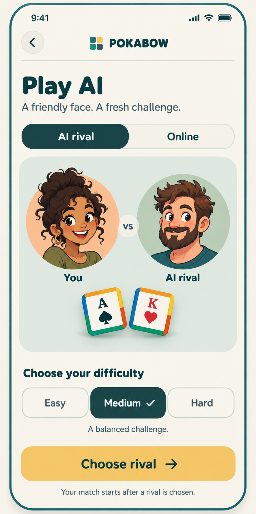

# Play AI — Modern Tabletop

Owner-approved concept, implemented 2026-10-19.

Generated with the built-in imagegen tool. The concept is an illustrative layout;
production uses native Fredoka text, shared theme tokens, the existing cartoon
portrait atlases, and TilePainter for the decorative tiles. No raster UI labels
or new character assets are used. Medium is an example selected state; Easy
remains the application's actual default.

Generation brief: a portrait Play AI page on warm ivory, with a compact POKABOW
header and back control, AI rival / Online modes, a sage You vs AI matchup panel,
strictly flat 2D cartoon human portraits, square rank-and-suit tiles, explicit
Easy / Medium / Hard segments, and one honey Choose rival action. Use rounded
Fredoka-style typography, deep teal text, restrained peach accents, generous
spacing and no fabricated progression or rewards. Preserve the existing flow:
choose difficulty, cycle through rivals, then automatically start the match.

On short screens, production reduces portraits and omits the decorative tiles
before allowing content scrolling. The main action and back route remain fixed.
The Online variant retains actual matchmaking status, Ready, retry and leave.
Reduced motion selects the portrait without cycling and keeps the result hold.
