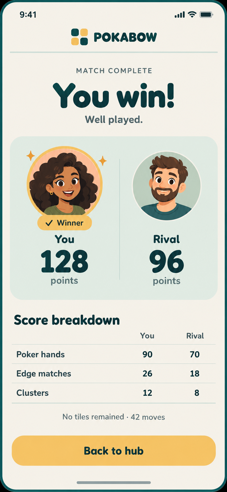

# Match results — Modern Tabletop

Owner-approved concept and subtle-animation direction, implemented 2026-10-19.

Generated using the built-in imagegen tool. The artwork is a reference, not the
runtime interface: all text, cards, tables, winner accents and buttons are native
Godot UI using Fredoka and shared Modern Tabletop tokens. Existing cartoon atlas
portraits and player-uploaded photos remain supported. Example scores in the
image are illustrative; runtime values come exclusively from MatchResult.

Generation brief: a single portrait results page with warm ivory canvas, teal
Fredoka-style type, a compact POKABOW header, You win heading, a sage two-player
score card, honey winner ring and labelled badge, two restrained sparkles, a
readable three-row score comparison, actual end reason/move count and one honey
Back to hub action. Clearly flat 2D cartoon avatars, generous spacing, no giant
trophy, diagonal sweep, confetti rain, invented rewards or extra navigation.

The implementation uses an 800ms finite entrance. The panel surface fades/rises,
the badge settles, the winner ring pulses once, and a player win has two brief
sparkles. Scores and exit remain available immediately. Reduced motion skips
the animation. See DESIGN_SYSTEM.md for the authoritative state and timing rules.
