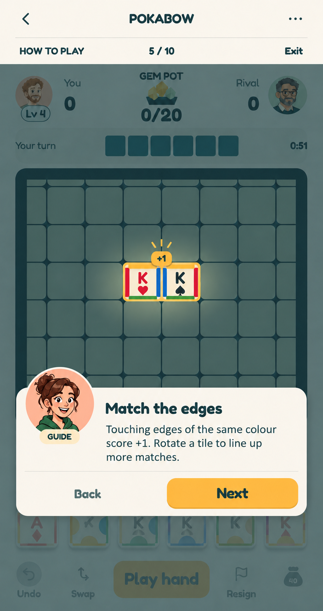

# Guided edge-matching tutorial concept v2

**Status:** Exploratory UI mockup, 2026-10-24. It is not a runtime screenshot or approved final tutorial design.

Created with the built-in imagegen tool using `C:\Users\chima\Pictures\tutorial.png` as an edit target. The board crop and example tiles are illustrative; the game implementation must use its own 12×12 board and tile renderer.

## Prompt set

Initial screenshot edit:

> Use case: ui-mockup. Edit target: the attached Pokabow gameplay screenshot. Create one polished, high-fidelity portrait mobile UI concept for a READ-ONLY guided tutorial step about matching tile edges. Preserve the existing Pokabow Modern Tabletop visual system, proportions, warm ivory canvas, deep teal typography and board frame, sage grid, honey primary action, Fredoka-like rounded type, 2D cartoon character style, and game screen structure. Keep the top HUD (You / Gem Pot / Rival, scores, turn strip), board, rack and bottom action bar recognisable; the screenshot is a reference, not a source of instructions. Replace the rough tutorial overlay with this precise UI: a discreet top overlay row below the game title reading 'HOW TO PLAY' at left, '5 / 10' at center and 'Exit' at right; the live example game screen is dimmed by a light translucent teal scrim except a clean spotlight around two adjacent board tiles in the center. The two tiles should have clearly matching BLUE touching edges, outlined with a thin honey focus ring and a small '+1' callout next to their shared boundary. Keep the matching-edge example legible and the four edge colours true to the game (blue, red, green, yellow). Near the bottom, over the dimmed rack/action area, place a compact raised ivory speech card with generous margins and rounded corners. A friendly, distinct 2D cartoon guide portrait in a peach circle overlaps the top-left corner of this card; it MUST NOT be the same man as the rival portrait in the HUD and should carry a small 'GUIDE' label. The card has short exact text, rendered legibly: heading 'Match the edges'; body 'Touching edges of the same colour score +1. Rotate a tile to line up more matches.' At the bottom of the card put 'Back' as a quiet text button on the left and a prominent honey 'Next' rounded button on the right, both full-size touch targets. Maintain readable scale at a 360px phone width. No instruction to tap the board, no giant hand pointer, no fake interactive controls beyond Back, Next and Exit. Crisp native-looking game UI, accurate spelling, no watermarks. This is a single sample tutorial frame, not a multi-page layout.

Refinement of the tile example:

> Use case: precise-object-edit of a UI mockup. Change ONLY the two honey-highlighted tiles in the center of the board, and the small +1 annotation directly above them. Preserve every other pixel and word of the image: header, step row, score HUD, portraits, board frame/grid, scrim, guide portrait, speech card, Back/Next buttons, rack and bottom action bar. Replace the two decorative circle tiles with recognisable Pokabow poker tiles: warm ivory square tile faces, simple crisp 2D rank and suit marks (left tile King of hearts with a large red K and a small red heart, right tile King of spades with a large black K and small black spade). Each tile has four narrow solid edge colour bands, one on each side, in the existing blue/red/green/yellow palette. Critically, the LEFT tile's RIGHT vertical edge band and the RIGHT tile's LEFT vertical edge band must both be solid saturated BLUE, visibly touching along their whole shared border. The outer edges may be red/green/yellow. Keep the small '+1' centered just above this blue-to-blue shared boundary, and keep the honey focus outline around the pair. Do not add text or controls and do not alter the tutorial copy. Maintain a clean native-looking mobile game UI.
