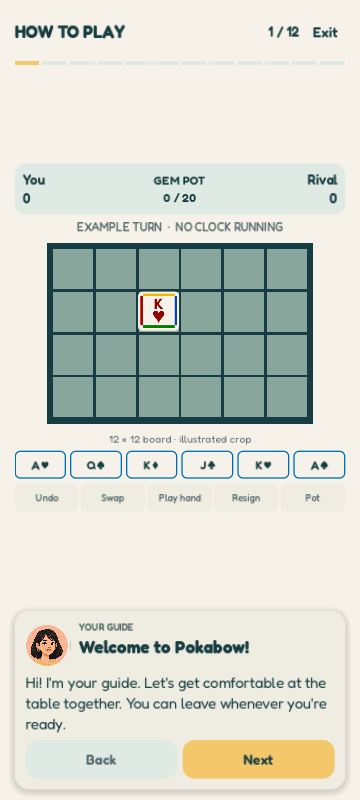

# 12 — Guided Tutorial Proposal

**Status: First-run guide implemented on 2026-10-24; further presentation ideas remain proposed.** This records the owner's tutorial mockup and the shipped local onboarding flow. It does not change game rules.

The image illustrates the intended visual direction. The current guide uses a separate cartoon portrait, a speech card and static illustrated board examples drawn with the game's tile painter. The board illustration is labelled as a crop of the 12×12 game board. The pictured spotlight and pointer animation remain proposed.

## Current implementation

- After a newly accepted account reaches the hub, a full-screen guide opens automatically above it. The first page is a warm introduction from the guide before any rules. The guide does not start a live match. Neither the guide nor a live turn has a move time limit under [ADR-023](../decisions/ADR-023-untimed-turns.md).
- Twelve read-only pages cover the table, placement and rotation, poker hands, matching edges and clusters, bottom controls, board navigation, rivals, Table Level and the projected Gem pot. **Back**, **Next** and **Exit** remain available. The example board and bottom actions are illustrative and cannot place or spend tiles.
- **Exit** offers **Remind me later**, **Don't show again** and **Keep learning**. Remind me later preserves the pending flag for the next launch. Finishing and Don't show again suppress automatic re-entry. A separate per-account local preference stores the choice.
- The hub's Settings panel provides **How to play** for manual replay, regardless of the saved first-run choice. Replay does not alter that choice unless the player finishes or selects Don't show again.
- Accounts already present before this feature are not automatically enrolled. New local accounts become eligible when their terms/account flow succeeds. Account deletion removes the associated local tutorial preference.
- Layout has been rendered at 320×568, 360×800 and 540×960. Physical phone touch, cutout and screen reader checks remain open.

## Purpose and format

Teach enough to let a new player start an AI match confidently, in about two to three minutes. Use a sequence of read-only illustrated scenes with **Back**, **Next**, a visible step count, and **Exit tutorial** on every step. No placement, rotation, or match decision is required to progress. Use short scripted changes to the illustrated board; provide still frames when reduced motion is enabled.

The owner's mockup gives the right visual direction: a friendly 2D cartoon face and a brief speech panel over the actual game layout. Build the walkthrough as a dedicated, non-live tutorial scene styled like the current game screen. Its example board, rack, scores and pot are clearly labelled examples. It creates no match, spends no tiles, awards no score or Gems, and sends no network request. Players can read at their own pace.

Use a **Guide** portrait distinct from the current rival portrait. The mockup repeats a similar character in both positions, which may make players think their opponent is giving instructions. Reuse the approved flat 2D cartoon style, warm ivory, deep teal, sage and honey, Fredoka, and the game's actual tile and icon rendering. Keep the guide portrait attached to a compact speech card, about two lines of text at a time. Dim non-target areas and spotlight the relevant part of the example screen. Move the speech card above or below the target so it never covers the rack or the bottom action being explained. A pointer hand can appear on the opening example, but avoid using it on every step because it implies the player must tap the staged scene.

## Proposed first-run and replay flow

1. After the splash and account/terms gate, open the guide above the hub for a newly created local player. Do not start a live match behind it. Existing accounts continue to the hub without a new automatic interruption.
2. **Exit** is always visible and opens a sheet with **Remind me later**, **Don't show again**, and **Keep learning**. The first two choices exit without a live-match consequence. Remind me later presents the guide on the next launch; Don't show again suppresses automatic presentation on this device for this account. Finishing the guide also suppresses automatic presentation.
3. Add **How to play** to the hub's Settings panel for replay at any time. Replay never changes the stored first-run choice.
4. Store only tutorial progress/visibility state, scoped to the local account. Do not use match saves or gameplay state as a tutorial flag.

The exact first-run eligibility for people who registered before this feature ships needs a product decision. The recommendation above avoids surprising existing players with an automatic full-screen guide.

## Storyboard and essential copy

Each row is one short screen. Copy is draft player-facing language; diagrams should use the real rule definitions and current controls.

| Step | Spotlight / example | Guide's key message |
| --- | --- | --- |
| 1. Welcome and screen map | Score header, 12×12 board, rack and turn strip | “I’ll show you the board, your tiles and the actions you need for a first hand.” |
| 2. Choose and place | One rack tile moving to a legal empty cell | “Drag tiles from your rack onto the grid. A highlighted cell shows where a tile can land.” Explain that tapping a tile selects it and tapping it again rotates it by 90°. A tap on an empty board cell does not place a tile. |
| 3. Make a poker hand | A horizontal Pair `K K`, then a vertical ordered 3-straight `J Q K` | “Build a straight line of two to five tiles. The line must make a recognised hand before you can play it.” Show rank order `J–Q–K–A`; no diagonal hands. |
| 4. Recognise the seven hands | Small illustrated reference grid | Show Pair, Two Pair, Three-of-a-Kind, Four-of-a-Kind, 3-straight, 4-straight and Full House. Include the permitted lengths from the current hand rule. Clarify that a straight's tiles must appear in rank order along the line. Do not show a five-tile straight, Five-of-a-Kind, High Card or Jokers. |
| 5. Match tile edges | Two touching blue edges; rotate one example tile | “Matching colours on touching edges earn +1 point for each new match. Rotate a tile to line up more colours.” Show one non-matching boundary as legal but worth no match point. |
| 6. Grow a colour cluster | Four tiles connected through one colour | “A connected group of four tiles with the same matching edge colour earns a cluster bonus.” The default is +3 per completed group of four. Keep the cluster visually separate from the poker line. |
| 7. Preview, Play and Undo | Staged line, score preview, Play hand and Undo | “Your tiles stay unconfirmed until you press Play hand. Check the preview; use Undo to return staged tiles.” Mention that a hand can score more than its category points through tile values and the current hand bonuses; the preview is the reliable total. |
| 8. Other bottom actions | Swap, Resign and Pot, one at a time | “Swap lets you select tiles to exchange. Resign ends the match after confirmation. Pot shows the remaining tiles, but not their draw order.” During Swap, Play hand changes to a Swap action and Undo becomes Keep. |
| 9. Explore and take turns | Pan/pinch demonstration and turn strip | “Your turn has no time limit. Drag empty board space to look around; pinch to zoom between the close view and the full board. Play, swap or resign when you're ready.” Include the top-right menu as a route to match options. |
| 10. Rivals, levels and Gems | Rival selector, `Lv` chip, Gem pot | “Choose an Easy, Medium or Hard AI rival, or play online. Table Level grows from completed, verified online matches, not AI matches. Poker hands grow the displayed Gem pot.” State plainly that the current Gem amounts are **projections**, with account crediting still unavailable; avoid promising spendable rewards. |

The seven-hand reference can also be available from **How to play** as a compact, skippable reference page so the main flow does not require memorisation. Avoid teaching exact score arithmetic on every first-run step; the score preview and a later scoring reference can handle detailed card, suit, colour and new-edge factors.

For the reference page, use this exact hand set:

| Hand | Valid line length | Simple example |
| --- | --- | --- |
| Pair | 2–5 | `K K` |
| Two Pair | 4 | `K K Q Q` |
| Three-of-a-Kind | 3–4 | `A A A` |
| Four-of-a-Kind | 4 | `J J J J` |
| 3-straight | 3 | `J Q K` |
| 4-straight | 4 | `J Q K A` |
| Full House | 5 | `A A A Q Q` |

## Rules and implementation boundaries

- The tutorial is presentation-only. Illustrations must match the current `PokerHandEvaluator`, placement validator, tile rotation, `GameBottomNavigation`, edge scorer and cluster scorer. Do not duplicate those algorithms as a second tutorial rule engine.
- The current hand list is closed: legal connected runs are 2–5 tiles and every touched run of at least two tiles must classify as a permitted hand. A tutorial example should be validated with game rules before release.
- Matching edges score +1 per newly committed matching boundary. Colour clusters are separate flat milestone awards. Hand score also includes tile values and approved factors; do not claim that edge matching is the only bonus.
- Table Level is server-owned and online-only. The displayed match Gem pot and results are currently projections; wallet settlement and spendable account balance are not implemented.
- The tutorial should work without network access and should not reveal hidden rival tiles or actual future draw order.
- Tutorial examples and live matches have no move countdown. Closing the guide, opening match settings or leaving and returning to a match does not consume a turn. Future pending-move reminders will not impose a deadline.

## Acceptance checks for implementation

- First-run guide starts only for the intended player; Exit, Don't show again, completion and replay persist as intended across app restart and account switch.
- Every step has a working Back, Next and Exit path. The example turn strip and turn lesson clearly say there is no move time limit; entering or leaving the guide cannot consume a live turn.
- At 320×568, 360×800 and 540×960, portrait, copy, target and navigation remain visible with at least 48px physical tap targets and no obscured essential example.
- Screen reader labels describe the target and example without relying on colour alone. Reduced motion displays each demonstration as a still. Text is readable in light and dark themes.
- Poker, edge, cluster, level and Gem statements are checked against current source and specification before shipping. Device cutouts, touch and orientation still need physical-phone verification.

## Source references

- [Gameplay rules](../GAME_SPEC.md), especially sections 5.3–5.7 and 13.5.
- [Untimed turns](../decisions/ADR-023-untimed-turns.md).
- [Mobile interaction](05-mobile-ux.md), especially staged-line interaction and current action bar.
- [Edge cluster decision](../decisions/ADR-002-edge-cluster-definition-and-bonus.md).
- [AI rivals and Table Level](06-game-modes.md).
- [Gem pot status and limitations](11-gems-and-match-pot.md).
- [Modern Tabletop design system](../DESIGN_SYSTEM.md).
